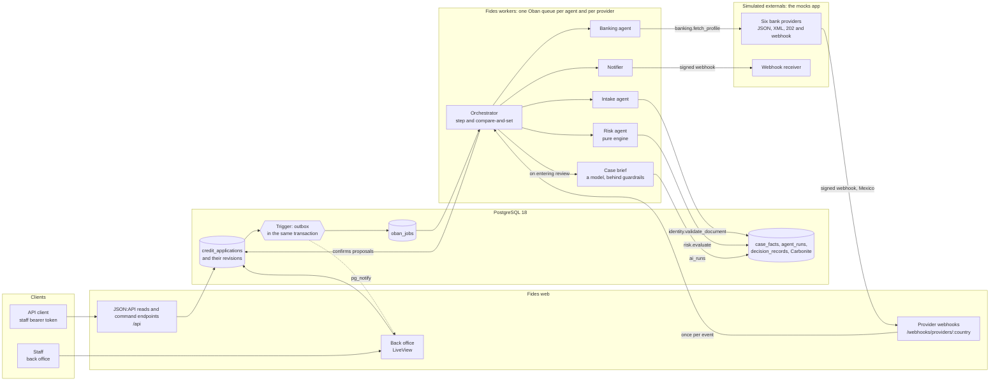
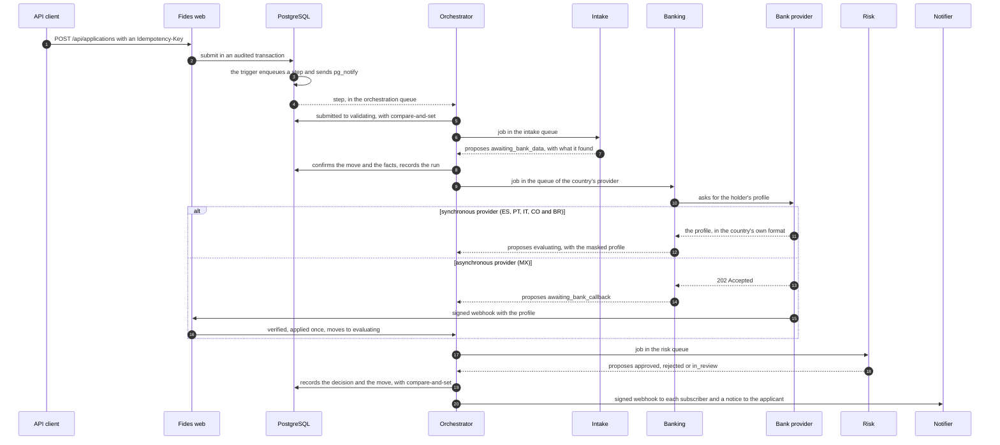
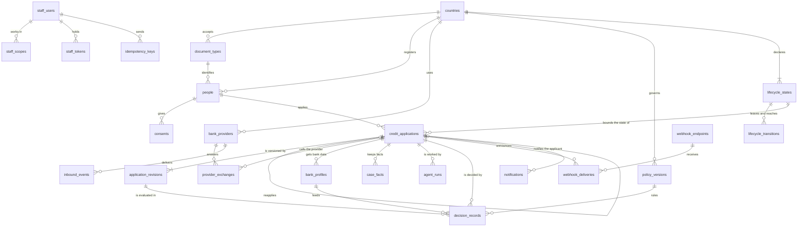

# Fides

Multi-country credit origination, built as a multi-agent system. It runs in six countries (ES, PT, IT, MX, CO and BR), each with its own identity document, bank data provider, risk rules and life cycle.

Fides takes a credit application, checks the holder's document for the country, fetches bank data from that country's provider, decides with a deterministic, versioned policy, and notifies whoever subscribed. Every step runs in the background, leaves evidence, and can be replayed.

Built with Elixir 1.20, Phoenix 1.8, Ash 3, Oban and PostgreSQL 18.

| Area | Status |
| --- | --- |
| API: create, read, list with filters, move, answer and reapply | Done |
| Six countries: documents, providers, rules and life cycles | Done |
| Background agents, orchestrated from a Postgres trigger | Done |
| Signed webhooks in (Mexico's provider) and out (subscribed receivers) | Done |
| Back office: sign-in, live inbox, an application's detail with its evidence, moves, personal data revealed with a reason, new applications, answers and reapplications, policy versions and the console | Done |
| The AI case brief for analysts, with guardrails and a simulated model by default | Done |
| `make run` with Docker alone, `make demo` with the three scenarios, the container image, compose and the Kubernetes manifests | Done |
| Cache and structured JSON logs | Not in this delivery: see [Out of scope](#out-of-scope-and-why) |

## Contents

- [Run it](#run-it)
- [Demo users and how to sign in](#demo-users-and-how-to-sign-in)
- [Try it](#try-it)
- [Architecture](#architecture)
- [The four agentic primitives](#the-four-agentic-primitives)
- [Answers to the four questions](#answers-to-the-four-questions)
- [Countries, documents and rules](#countries-documents-and-rules)
- [Life cycle per country](#life-cycle-per-country)
- [Asynchronous processing, webhooks and concurrency](#asynchronous-processing-webhooks-and-concurrency)
- [Data model](#data-model)
- [Security and privacy](#security-and-privacy)
- [Observability and evidence](#observability-and-evidence)
- [Scalability](#scalability)
- [Cache](#cache)
- [Deployment](#deployment)
- [Key decisions](#key-decisions)
- [Assumptions](#assumptions)
- [What we ask for beyond the challenge](#what-we-ask-for-beyond-the-challenge)
- [Out of scope, and why](#out-of-scope-and-why)
- [Repository map and tests](#repository-map-and-tests)

## Run it

You need Docker. Elixir 1.20 with Erlang/OTP 29 is needed only to develop from the host.

```sh
make run      # PostgreSQL 18, the migrations and seeds, a web node on :4000, a worker and the
              # simulated providers on :4010, all from their images; the first run builds them
make demo     # the three scripted scenarios against the running app, followed state by state
make code     # a demo staff user's current TOTP code, to sign in to the back office
make logs     # Fides and the mocks, live
make down     # stop everything; the database's volume stays
make deploy   # the Kubernetes manifests, on the current kubectl context (see Deployment)
make          # every target, with what it does
```

`make run` writes development keys to `deploy/compose.env` the first time. The first run builds the two images, which takes a few minutes; `FIDES_IMAGE=ghcr.io/ruben44bac/fides:main make run` pulls the published one instead. `make code` and `make demo` take `STAFF=analyst_mx` for another demo user, and `LOCAL=1` runs them from the host.

From the host, with the toolchain installed:

```sh
LOCAL=1 make run   # PostgreSQL in Docker; Fides and the mocks with mix, hot reloading included
make test          # the whole suite
make migrate       # the migrations, triggers included
make seed          # the reference data, the life cycles and the demo staff, again
make token         # a bearer token for a demo staff user, while Fides runs
```

Nothing needs an external credential: the bank providers and the webhook receiver are simulated by the `mocks` app, and every development key has a default or is generated. `.env.example` lists the variables, and which ones production requires.

**Demo staff:** six users, one password and a second factor, the same in every environment: see [Demo users and how to sign in](#demo-users-and-how-to-sign-in).

**Useful URLs:**

- API explorer: <http://localhost:4000/api/swaggerui>, and the OpenAPI document at `/api/open_api`.
- Webhooks the simulated receiver got: <http://localhost:4010/webhooks/page>.
- Emails sent to applicants, in development: <http://localhost:4000/dev/mailbox>.
- Back office: <http://localhost:4000/backoffice>. Sign in with a demo user's email, the shared password and the code from `make code`: the inbox, each application's detail, the policies and the console.

A Postman collection in `postman/` walks through every endpoint, signs in with the TOTP codes, and follows the orchestrator.

## Demo users and how to sign in

This is how the team tries Fides from the first minute, in every environment. Each one seeds the same six demo staff. They share the password `fides demo password`, and each has a second factor: a TOTP code that stays current for 30 seconds and works once, so signing in twice within those seconds fails the second time.

| Handle | Email | Can |
| --- | --- | --- |
| `analyst_es` | `analyst.es@fides.test` | Work applications in Spain |
| `analyst_mx` | `analyst.mx@fides.test` | Work applications in Mexico |
| `risk_manager_1`, `risk_manager_2` | `risk.manager1@fides.test`, `risk.manager2@fides.test` | See every country's applications; one proposes a policy version and the other approves it |
| `admin` | `admin@fides.test` | Manage staff and webhook receivers |
| `auditor` | `auditor@fides.test` | Read everything, change nothing |

**A user's current code.** Every environment but production sets `FIDES_DEMO_TOTP_SEED` to the development phrase, so the codes can be computed from any checkout with the toolchain: `mix fides.code analyst_es`. Without the toolchain, the running app prints them:

| Environment | Start | Back office and API explorer | A user's code |
| --- | --- | --- | --- |
| Docker alone | `make run` | <http://localhost:4000/backoffice>, <http://localhost:4000/api/swaggerui> | `make code STAFF=analyst_es` |
| From the host | `LOCAL=1 make run` | The same | `LOCAL=1 make code STAFF=analyst_es` |
| Kubernetes, on kind | `make deploy` ([`deploy/k8s`](deploy/k8s/README.md)) | <http://localhost:30400/backoffice>, <http://localhost:30400/api/swaggerui> | `kubectl -n fides exec deploy/web -- /app/bin/fides eval 'Fides.Release.code("analyst_es")'` |
| Hosted demo, on Fly.io | Deployed from `main` ([`deploy/fly`](deploy/fly/README.md)) | <https://fides-demo.fly.dev/backoffice>, <https://fides-demo.fly.dev/api/swaggerui> | `fly ssh console --app fides-demo -C "/app/bin/fides eval 'Fides.Release.code(\"analyst_es\")'"` |

Production sets no seed and has no demo staff.

**Signing in:**

1. **Back office.** Open the environment's `/backoffice` and enter the user's email, the password and the current code. Each user sees what their role allows: an analyst, their country's applications; a risk manager, every country's applications and policies; the auditor, everything, read only.
2. **API.** `make token STAFF=analyst_es` signs the user in against localhost with the password and the current code, and prints a bearer token to send as `Authorization: Bearer`; for another environment, `FIDES_URL=https://fides-demo.fly.dev mix fides.token analyst_es`.
3. **The three scenarios.** `make demo` against localhost, or `FIDES_URL=<the environment> mix fides.demo`, runs them through the API and follows them state by state while the inbox shows them move.

The hosted demo has a walkthrough for the team, screen by screen, in [`deploy/fly/README.md`](deploy/fly/README.md#trying-it).

## Try it

```sh
TOKEN=$(make -s token STAFF=analyst_es | tail -n 1)
H=(-H "Authorization: Bearer $TOKEN" -H "Accept: application/vnd.api+json" -H "Content-Type: application/vnd.api+json")

# Submit an application in Spain: 15 000,00 EUR with a monthly income of 3 000,00 EUR
# (commands answer with the application as plain JSON; jq picks its id)
ID=$(curl -s "${H[@]}" -H "Idempotency-Key: $(uuidgen)" http://localhost:4000/api/applications -d '{
  "data": {
    "country_code": "ES", "amount_minor": 1500000, "monthly_income_minor": 300000,
    "currency": "EUR", "channel": "api", "consent_text_version": "2026-10",
    "holder": {"document_type": "DNI", "document": "12345678Z", "given_names": "Ana",
               "first_surname": "Ruiz", "email": "ana.ruiz@example.com"}
  }
}' | jq -r .id)

# Read it back: its state moves on its own, a second or two later
curl -s "${H[@]}" http://localhost:4000/api/applications/$ID

# List, filtered by country, state, amount and date, a page at a time (keyset)
curl -sg "${H[@]}" "http://localhost:4000/api/applications?filter[country_code]=ES&filter[state]=in_review&page[limit]=10"

# Search by document: it travels in the body, never in the URL
curl -s "${H[@]}" http://localhost:4000/api/applications/search -d '{"data": {"country_code": "ES", "document": "12345678Z"}}'

# The moves this staff user can make now, with the current version; then one of them,
# for example on an application in review
curl -s "${H[@]}" http://localhost:4000/api/applications/$ID/transitions
curl -s "${H[@]}" -H "Idempotency-Key: $(uuidgen)" http://localhost:4000/api/applications/$ID/transitions \
  -d '{"data": {"to": "approved", "reason": "Income covers the instalments", "expected_version": 7}}'
```

Errors say what happened:

| Code | When |
| --- | --- |
| 401 | No token, or an invalid, expired or revoked one |
| 403 | The actor can see the application, but their role does not allow the move |
| 404 | The application does not exist, or is outside the actor's countries |
| 409 | `expected_version` is stale: the application changed first |
| 422 | Invalid data, with an error per field; a move the life cycle does not allow, with the allowed ones; or an `Idempotency-Key` reused with another body |

Amounts are integers in minor units of the country's currency: `1500000` is 15 000,00 EUR.

## Architecture

### Agentic architecture



### The flow of an application



Every arrow into the database is one audited transaction, and every write to an application enqueues the next step in that same transaction. A step that finds the application already at another version does nothing, because the write that changed it enqueued its own step.

## The four agentic primitives

**Agents.** Each agent is an Oban worker in its own queue, with its own identity (`AgentActor`). It is handed an assignment with no personal data and returns a proposal: `{:advance, %{to: state, tool: tool, facts: facts}}`, `{:retry, reason}` or `{:escalate, reason}`. No agent writes the application's state.

**Tools.** Each tool is an Ash action with typed arguments, policies and audit, so the same contract serves code and, later, a model: `identity.validate_document`, `banking.fetch_profile` and `risk.evaluate`. An agent may only call what its identity allows.

**State and memory.**

| Memory | Where | Kept |
| --- | --- | --- |
| State | `credit_applications.state` with `lock_version`; the database enforces each country's transitions | Life of the application |
| Working memory | `case_facts`: what each agent found, with the agent, the tool, the version and a hash. A newer fact replaces an older one without deleting it | Life of the application |
| Episodic memory | `agent_runs`: every run, with its job, attempt, input hash and outcome | As evidence |
| Decisions | `decision_records`: everything a decision depended on | As evidence |
| Long-term memory | The holder's history across applications, which the 30-day rule reads | Regulatory window |

Agents never talk to each other: they read the facts of the case, like a blackboard.

**Flows and orchestration.** Each country's life cycle declares, as data, what runs on entering each state: the orchestrator's own move, an agent, a timeout, a scheduled retry, a signed webhook or a notice. The orchestrator is the only writer of state. It confirms a proposal only while the application is still at the version the agent saw (compare-and-set on `lock_version`), together with the agent's facts, in one transaction.

## Answers to the four questions

### What does each agent do, and why this split?

| Agent | Runs on entering | Responsibility | Sees | LLM |
| --- | --- | --- | --- | --- |
| Orchestrator | Every write | Applies the country's life cycle, confirms proposals with compare-and-set, and is the only writer of state | Id, country, state and version | No |
| Intake | `validating` | Checks the document for the country against the stored name, and adulthood where the document encodes a birth date. It leaves facts and always moves on: rejecting is Risk's job, with a reason | Name and document, only through `identity.validate_document` | No |
| Banking | `awaiting_bank_data` | Asks the country's provider in that provider's own queue, normalizes the answer through the provider's adapter, and keeps a masked profile. Retries with backoff under the same request id, then `provider_error` | The document, only to ask the provider | No |
| Risk | `evaluating` | Builds canonical inputs (Intake's facts, the bank profile, the holder's history) and decides with the policy version in force. Records the decision | Financial and public data only, never a name, document or email | No |
| Notifier | `approved`, `rejected`, `info_requested` | Sends signed webhooks to subscribers and a notice to the applicant | Ids, country, state and reason codes | No |

The split follows the kinds of risk:
- **Identity** handles personal data.
- **Banking** does slow, unreliable external I/O, isolated in one queue per provider so a slow provider never holds the others up.
- **Risk** makes a pure decision that must be reproducible.
- **Notifier** handles outbound, at-least-once communication.

Each agent can then have the least data it needs, enforced by its identity's policies, and fail without dragging the others.

### Which part uses an LLM, and how is a decision reproducible and auditable?

**No LLM is in the decision path.** The orchestrator and every agent above are deterministic code. A credit decision is never made, changed or explained to the applicant by a model.

**Where a model helps: the case brief.** When an application enters review, the life cycle names the `case_brief` capability and the orchestrator enqueues it, in the AI's own queue and with the AI's own identity. The model gets the pseudonymized facts alone, the terms, the decision with what every rule said and the canonical inputs, financial and public data only, and answers a summary and the signals the analyst should look at first, as structured output. Guardrails check it before it is shown: the shape, every number backed by the input, every rule that objected mentioned, nothing that looks like personal data. A refused answer is asked for once more with the refusal; after that, or when the model fails, a template written from the same facts stands in. Every invocation leaves an `AiRun` with the model, the hashes of prompt and input, the output, the guardrails' verdict, tokens, cost and latency. The simulated model answers by default, free and offline; `FIDES_LLM_MODEL` with the provider's key names a real one through ReqLLM. The AI reads applications, decisions and facts, the holder does not exist for it, and it may move nothing: the brief assists, the analyst decides.

**Reproducible.**
- The engine is a pure function: rule logic is code, and thresholds are parameters of a versioned policy.
- A policy goes from draft to published only with a second risk manager's approval, and publishing retires the previous one.
- Each `DecisionRecord` keeps:
  - the revision it evaluated, the policy version and the bank profile;
  - the canonical inputs and their hash, and what each rule said;
  - the outcome with its reason codes;
  - the engine's code SHA and a hash of the whole decision.
- The same inputs under the same policy always give the same hash. A reevaluation, for example after a new policy is published, records a new decision that points at the one it replaces.

**Auditable.**
- Every write runs inside a Carbonite transaction that records the actor, action, reason, country and code SHA. A write without that context fails in the database, raw SQL included.
- `decision_records`, `application_revisions`, `agent_runs` and `case_facts` are append-only.
- `provider_exchanges` keeps the hashes of each call to a provider, and `inbound_events` keeps the hash of each webhook received.

### What does each agent see, and how is personal data protected?

The "Sees" column above is enforced, not conventional:

- **Classification is code.** Every attribute of every resource is classified as `pii`, `financial`, `pseudonymous`, `internal` or `public`, and an unclassified attribute does not compile. `priv/generated/data-inventory.md` is generated from it, and CI fails if it is stale.
- **Encrypted, findable without decrypting.** The holder's name, document and email are encrypted at rest (AshCloak). Fides finds holders by a keyed HMAC of the document or email (a blind index), with a key separate from the encryption key.
- **Agents get no PII by default.** Their assignment carries ids, country, state and terms. An agent loads anything else through the tools its identity allows; Risk's identity cannot read a name, a document or an email.
- **Bank data is minimized.** The account is kept as its last four characters, and the provider's answer is never stored: only its hash and the normalized profile.
- **Nothing leaves with PII.** Outgoing events carry ids, country, state and reason codes. The applicant's email is resolved by the mailer, with its own identity, at the moment of sending. API responses carry no personal data, and request logs filter passwords, TOTP codes, emails and tokens.
- **Staff see their countries only.** An application outside the actor's countries does not exist for them (404).

### How does the system recover when an agent, a tool or a provider fails mid-flow?

| Failure | What happens | Evidence |
| --- | --- | --- |
| A worker dies mid-step | Oban's lifeline puts the job back. A job runs once per agent and application version, and compare-and-set makes a second confirmation impossible | `agent_runs` |
| An agent fails | It asks to retry, with backoff, up to five attempts. On the last one, Banking proposes `provider_error`, and the others escalate to a person | `agent_runs` with the reason |
| A provider is slow, down or answers garbage | A 5-second timeout, retries with backoff under the same request id, then `provider_error`, from where a scheduled retry starts over. Only that provider's queue is affected | `provider_exchanges`, one per attempt |
| Mexico's webhook never arrives | A timeout (10 minutes by default) moves the application to `provider_error`, and the scheduled retry asks again | The timeout's move |
| A webhook arrives twice, late or forged | Each event applies once per provider. One for an application that moved on is recorded as ignored. A bad signature is rejected and recorded, and does not block the genuine event | `inbound_events` |
| A webhook receiver is down | Up to 8 attempts with backoff, then the delivery is marked failed | `webhook_deliveries` |
| Two workers or people act at once | Compare-and-set lets one win. The other's proposal is dropped as superseded, and the winning write enqueued its own step | `agent_runs` with `superseded` |
| No policy in force, or no bank profile | The case escalates to a person | `agent_runs` with `escalate` |
| A new policy is published | Applications waiting for review under an older version go back to evaluation, each with its cause | A new decision that replaces the old one |

No work is lost between a write and its next step: both commit, or neither does.

## Countries, documents and rules

| Country | Document | Currency | Provider format | Country rule (policy v1) | Countersignature |
| --- | --- | --- | --- | --- | --- |
| ES | DNI or NIE: 8 digits and a mod-23 letter; a NIE starts with X, Y or Z | EUR | JSON, amounts in cents | Above 20 000 EUR goes to review | Above 50 000 EUR |
| PT | NIF: 9 digits, mod-11 check digit | EUR | JSON, Portuguese fields, amounts like "2.500,00" | Up to 6× the monthly income approves, up to 8× goes to review, above rejects | Above 50 000 EUR |
| IT | Codice Fiscale: 16 characters with a check character, omocodia included, matched against name, birth date and sex | EUR | XML | Income in each of the last 6 months, of at least 1 200 EUR a month; otherwise rejects | Above 50 000 EUR |
| MX | CURP: 18 characters with a check digit, matched against name and birth date | MXN | 202, then the profile by signed webhook | The monthly income must be at least 20% of the amount | No |
| CO | Cédula de Ciudadanía: 6 to 10 digits | COP | JSON, whole pesos, reports the total debt | The total debt must stay within 5× the monthly income | No |
| BR | CPF: 11 digits, two check digits, repeated sequences rejected | BRL | JSON, amounts in centavos, score from 0 to 1000 | A score of 600 or more approves, 450 to 599 goes to review, below rejects | No |

Common rules apply in every country before its own:
- **Eligibility:** a valid document, an adult holder where the document encodes the birth date (IT, MX), and a declared income above zero. Failing any of them rejects.
- **History:** a rejection of the same holder in the last 30 days sends the application to review, a reapplication included.
- **Income consistency:** if the bank observes an income more than 15% below the declared one, an analyst decides (`income_mismatch`). The rules of PT, MX and CO use the declared income, and the bank checks it.

The decision is the most severe of all rules: reject, then review, then approve. Thresholds are ours, and they are parameters of each country's policy, not code.

## Life cycle per country

Every country has a base cycle plus what its variant declares:

| Countries | Bank data | Countersignature | Own state |
| --- | --- | --- | --- |
| ES, PT, IT | Synchronous | Above the policy's threshold | `pending_countersign` |
| CO, BR | Synchronous | No | None |
| MX | Asynchronous, by signed webhook | No | `awaiting_bank_callback` |

The base states are `submitted`, `validating`, `awaiting_bank_data`, `evaluating`, `in_review`, `info_requested` and `provider_error`. The final states are `approved`, `rejected` and `cancelled`, and they never change.

- **Who moves what.** The system makes the moves up to the decision. An analyst approves, rejects or asks for information. A risk manager countersigns. The applicant, or an analyst on their behalf, answers a request for information with a new revision. Any open state can be cancelled.
- **Diagrams.** Each country's diagram is generated from the code into `priv/generated/life-cycles.md`, and CI fails if it is stale.
- **Code defines, the database enforces.** The seeds write each country's states and transitions to `lifecycle_states` and `lifecycle_transitions`. A foreign key keeps every application in a state of its country, and a trigger rejects any change of state that is not one of its country's transitions, raw SQL included.
- **Extending it.** A new state or country is a change to a variant module and its seeds. The base cycle and the other countries stay as they are.

What runs on entering each state is declared next to the cycle. A capability runs where the configuration says, so the life cycle names it without the orchestrator depending on what runs it; a queue effect is the inbox filtered by that state.

| State | Effect | Runs today |
| --- | --- | --- |
| `submitted` | The orchestrator moves to `validating` | Yes |
| `validating` | Intake agent | Yes |
| `awaiting_bank_data` | Banking agent | Yes |
| `awaiting_bank_callback` | Timeout for the provider's webhook | Yes |
| `evaluating` | Risk agent | Yes |
| `in_review` | Review queue and the case brief | The brief; the queue is the inbox |
| `provider_error` | Scheduled retry, and an alert on the console | Yes |
| `pending_countersign` | The risk managers' queue | The inbox, filtered |
| `info_requested`, `approved`, `rejected` | Signed webhook and a notice to the applicant | Yes |

## Asynchronous processing, webhooks and concurrency

**From a data change to a queue.** An `AFTER INSERT OR UPDATE` trigger on `credit_applications` inserts an `Orchestration.Step` job into `oban_jobs` and sends `pg_notify('credit_applications', …)`, both in the transaction of the write. It is a transactional outbox: if the write rolls back, there is no job.

**Queues.** One per agent and one per provider, so neither a slow provider nor a busy agent holds the rest:

| Queue | Concurrency per node |
| --- | --- |
| `orchestration` | 10 |
| `intake` | 5 |
| `banking_es`, `banking_pt`, `banking_it`, `banking_mx`, `banking_co`, `banking_br` | 2 each |
| `risk` | 5 |
| `reevaluation` | 1 |
| `webhooks` | 5 |
| `notices` | 5 |
| `ai` | 2 |

**Webhooks.**
- **Inbound:** Mexico's provider answers 202 and delivers the profile later to `POST /webhooks/providers/MX`. The signature is `t=<unix seconds>,v1=<HMAC-SHA256 of "<seconds>.<body>">`, refused if older than 5 minutes. Each event applies once.
- **Outbound:** on `approved`, `rejected` and `info_requested`, every receiver subscribed to the event, and to the country if it filters by one, gets a signed delivery without personal data.
- The `mocks` app plays both ends. Its knobs (`MOCKS_ERROR_RATE`, `MOCKS_TIMEOUT_RATE`, `MOCKS_MALFORMED_RATE`, `MOCKS_WEBHOOK_DUPLICATES`, `MOCKS_RECEIVER_DOWN` and others) make providers slow, failing or malformed, and the receiver unavailable, to watch Fides recover.

**Concurrency.** Any number of workers can run the same queues:
- Oban hands each job to one worker.
- An agent's job is unique per agent and application version.
- Every state change is a compare-and-set on `lock_version`, so two workers, or a worker and a person, can never both move the same application.
- A partial unique index allows one open application per holder and country, which also stops double submissions.
- A stateful test runs random sequences of submissions, moves, answers, reapplications and cancellations, and checks the invariants never break. Another one runs people and agents on the same applications at once.

**How it scales.**
- Web nodes are stateless.
- Workers scale horizontally on queue depth, and a provider's queue limit respects its rate limit.
- Postgres coordinates everything, so adding a node needs no other service.
- The real bottleneck is the providers, and each is isolated.

## Data model



- **Three levels of identity.** A holder (`people`) is the person the credit is for: one per document and country, with personal data encrypted. Staff (`staff_users`) are global and enter each country through a scope (`staff_scopes`), with the role of analyst or risk manager.
- **Revisions, not edits.** An answer to a request for information adds a revision (`application_revisions`, append-only). A rejection is never reopened: a reapplication is a new application that points at the previous one, once.
- **The country is the root.** Every table with a country's data carries `country_code`. Its foreign keys to other per-country tables include it, so a row can never point at another country's row, and a trigger makes `country_code` immutable. The currency always matches the country's.
- **Conventions.** Ids are UUIDv7, money is integers in minor units with its currency, and times are UTC.

## Security and privacy

- **Authentication.**
  - Staff sign in with a password and a TOTP second factor (`POST /api/auth/token`) and get a bearer JWT valid for 15 minutes, stored and revocable (`DELETE /api/auth/token`).
  - Five failures in a row lock sign-in for 15 minutes.
  - The staff token's signing key is separate from every other key.
- **Authorization.**
  - Ash policies on every action, by role (analyst, risk manager, admin, auditor) and by country scope.
  - The auditor reads every country and writes nothing.
  - Agents act with their own identity and only their tools; the AI's capability reads applications, decisions and facts, never a holder, and may move nothing.
- **Separation of duties.** Publishing a policy needs a second risk manager, and the database checks it too. In countries with a countersignature, a large approval needs a risk manager besides the analyst.
- **Personal and bank data.** See the third question above: classification, encryption, blind index, masking, hashes instead of payloads, and no personal data in events or logs. In the back office, revealing a holder's personal data needs a reason, and every reveal is logged with who, what and why.
- **Integrity.**
  - Commands take an `Idempotency-Key`, kept per staff user with a hash of the request.
  - Moves take `expected_version`.
  - Webhooks are signed both ways.
  - Pages carry a Content-Security-Policy with a per-request nonce.
- **Repository.** Data is synthetic, development secrets are defaults only for development, and CI runs gitleaks.

## Observability and evidence

What happened to any application, in any asynchronous flow, can be rebuilt from the database, and the back office shows it on the application's detail page:

| Question | Where |
| --- | --- |
| Who changed what, when and why | Carbonite: one transaction per write, with actor, action, reason, country and code SHA, and its row changes |
| Which agent ran, on which attempt, with what input and outcome | `agent_runs` |
| What each agent found | `case_facts` |
| Every call to a provider, and how it went | `provider_exchanges` |
| Every webhook received, valid or not, and what became of it | `inbound_events` |
| Every webhook sent, its attempts and status | `webhook_deliveries` |
| Every decision and everything it depended on | `decision_records` |

The console in the back office shows the operation as it is: the depth of every queue, each provider's recent calls with the applications waiting in provider error, and the webhook deliveries that failed every attempt, to send again. Logs are plain text with the request id, and they filter credentials and emails. Structured JSON logs are not in this delivery. In development, LiveDashboard (`/dev/dashboard`) shows the BEAM, Phoenix and Oban metrics.

## Scalability

**Sizing assumption.** One million applications a day is about 12 per second on average, and 120 at a tenfold peak. At roughly 20 writes per application (state, facts, runs, decisions and audit), the peak is about 2 400 writes per second, within what one well-tuned Postgres primary sustains. Providers saturate first, and they are isolated per queue.

**Critical queries and their indexes:**

| Query | Index |
| --- | --- |
| Inbox by country and state, newest first | `credit_applications (country_code, state, submitted_at DESC, id)`, with keyset pagination: no `OFFSET`, no full counts |
| The open application of a holder | Unique partial on `credit_applications (country_code, person_id)`, over the open states |
| A holder by document | Unique on `people (country_code, document_hash)` |
| An application by id | Primary key |
| An application's timeline: runs, facts, profiles, decisions, notices and deliveries | `(country_code, application_id, inserted_at)` on each of those tables |
| An incoming event applied once | Unique on `inbound_events (country_code, provider, event_id)` |
| An outgoing event delivered once per receiver | Unique on `webhook_deliveries (country_code, endpoint_id, event_id)` |
| The policy version in force | Unique partial on `policy_versions (country_code, status)` |

**Tables.**
- Hot tables stay narrow: an application holds its current terms, state and version, and everything else hangs from its id in append-only tables that only grow.
- Every per-country table leads its indexes with `country_code`, which is also the natural partition key.

**Archiving.**
- Closed applications outside the hot window move in batches, with everything hanging from them, to mirror tables in an `archive` schema. The window can never be shorter than the 30 days the history rule reads.
- Carbonite's evidence is exported and purged, so its tables keep only the recent window.
- Oban already prunes finished jobs after a day.
- Active counts come from small partial indexes, and historical counts from a daily rollup, never from `COUNT(*)` over millions of rows.

**Next steps at scale.**
- Read replicas for listings and reports.
- Partition the append-only tables by month, once evidence no longer depends on per-table triggers. Carbonite resolves its configuration by table name, which partitions break, so the MVP does not partition.
- A cell per data region (EU and LatAm), because `countries.data_region` is already the key.

## Cache

**Not implemented in this delivery.** This is the design:

| What | Why | How | Invalidation |
| --- | --- | --- | --- |
| The policy version in force, per country | Every evaluation reads it | `:persistent_term`, keyed by the version | Nothing to invalidate: publishing a version is a new key, and a published version never changes |
| A holder's bank profile | Providers are slow, cost money and rate-limit, and reevaluations reuse the profile | A local cache keyed by a keyed hash of the document and the provider, with a TTL per country | TTL, a provider's notice, or an analyst's refresh, broadcast to every node through PubSub |

There is no Redis: local caches add no service to the five-minute start, and both entries are cheap to rebuild.

## Deployment

One image serves every environment ([`deploy/README.md`](deploy/README.md)), built from [`deploy/Dockerfile`](deploy/Dockerfile) and published to GHCR by the Release workflow on every merge to `main`. What differs between environments is only how it is run:

- **One image, two roles.** `FIDES_ROLE=web` serves the API, the back office and inbound webhooks, and enqueues jobs without running any. `FIDES_ROLE=worker` runs every queue and is the only one that calls providers. The default, `all`, does both on one node. `/app/bin/setup` creates the database if missing, migrates and seeds; `GET /health` answers while the database does.
- **Docker alone.** [`deploy/compose.yml`](deploy/compose.yml) runs PostgreSQL and, under the `app` profile, the migrations, a web node, a worker and the mocks: that is `make run`.
- **Kubernetes** ([`deploy/k8s`](deploy/k8s/README.md), kustomize): a base with the web Deployment, Service and HPA, the worker Deployment, the migrations as a Job that removes itself once done, PostgreSQL for a demo as a StatefulSet, the mocks, and a NetworkPolicy so only workers reach the providers; and a local overlay for kind with the images built on this machine, applied with `make deploy`.
- **Hosted demo.** [`deploy/fly`](deploy/fly/README.md) runs the same image on Fly.io at <https://fides-demo.fly.dev>, deployed by the Release workflow, with the mocks as a second app on the private network and a walkthrough for the team.

## Key decisions

| Decision | Why |
| --- | --- |
| Each context is an Ash domain, with boundaries checked at compile time | A relationship across contexts, or a call into another context's internals, does not compile |
| Carbonite as evidence, captured by database triggers | It records actions, bulk updates and raw SQL alike, and a write without context fails closed |
| Outbox by a Postgres trigger into Oban | A write and its next step commit together; no dual write and no lost work |
| Policies as versioned data, logic in code | Thresholds change with the business; each decision points at the exact version, and publishing needs a second person |
| AI never decides credit | Decisions must be reproducible and explainable; models only assist people |
| Life cycles: code defines them, the database enforces them | Each state needs code that runs on entering it, so cycles change with a deploy; the database is the last guard |
| Holder separate from login | API applications have no user, and a person accumulates applications over time |
| Revisions and reapplications instead of edits | Every decision points at the exact terms it evaluated |
| Declared income decides, the bank checks it | Inflating the declared income no longer passes silently: a gap goes to an analyst |
| Holder names in parts | The CURP and the codice fiscale encode letters of each surname; a full name cannot be split reliably |
| Staff second factor, with separate token keys | Credit decisions need strong authentication; a staff token never works anywhere else |
| JSON:API reads and command endpoints | A state change is a command with an actor and a reason, not the edit of a field |
| No physical partitioning in the MVP | Carbonite resolves triggers by table name; country lives in domain, indexes and policies |
| No row-level security in the MVP | Ash policies already filter in SQL; RLS on reads would force a transaction per request |
| Local caches, no Redis | No extra service in the five-minute start |
| The life cycle names capabilities; the configuration says what runs them | The orchestrator depends on no AI code, and a capability nobody runs waits |

## Assumptions

- Amounts are integers in minor units of each country's currency (EUR, MXN, COP and BRL), and thresholds are in local currency.
- The server sets the initial state and the submission date, even if the client sends them.
- Applications carry no term or rate, so Brazil decides by score rather than repayment capacity, and nothing quotes rates.
- The challenge's frontend is the staff back office; an applicant portal is out of scope.
- Each holder has at most one open application per country.
- Staff are global and work in the countries of their scopes.
- All data is synthetic: documents have valid check digits, and names are fictitious.

## What we ask for beyond the challenge

The challenge lists country, full name, document, amount, monthly income, date, initial state and bank data. A submission also asks for:

| Field | Why |
| --- | --- |
| `Idempotency-Key` | A client that times out retries with the same key and gets the first answer. Without it the domain still stops duplicates, but the retry would get an error |
| `consent_text_version` | Consent is auditable only if it records the text that was shown |
| `currency` | Money always travels with its currency, so an amount in the wrong unit cannot slip through |
| `document_type` | Scales to countries with several documents of similar formats |
| The name in parts | Exact cross-check with the CURP and the codice fiscale |
| The holder's email | Every holder can be notified |
| Birth date in IT and MX, and sex in IT | Settles the century of the codice fiscale and catches data mapped wrong |

A missing field answers 422 and names the field.

## Out of scope, and why

| Left out | Why |
| --- | --- |
| Applicant portal and a conversational intake with retrieval | The largest attack surface, and not needed for the challenge's flow |
| A model catalog with shadow models, eval gates and budgets | No real traffic to justify it; the gateway shape is ready for it |
| Back-office assistant over tools | Assistive only; the back office works without it |
| Signed export of evidence with a hash chain and WORM storage | Carbonite already keeps the evidence; the chain adds tamper-evidence outside the database |
| Archiving, k6 load tests and benchmarks over millions of rows | Explained above, not built |
| OpenTelemetry traces, dashboards and alerts | Logs and evidence tables already rebuild any flow |
| Per-country physical partitioning, row-level security, crypto-shredding and pgaudit | Each costs more than it shows at this size; see Key decisions |
| A generator for new countries | A new country is a variant module, a validator, an adapter, a policy and seeds |

**Required, but not in this delivery.** The time went to the end-to-end flow, the evidence behind it, the back office and the delivery itself:

| Missing | State |
| --- | --- |
| Cache | Designed (see [Cache](#cache)), not implemented |
| Structured JSON logs | Logs are plain text with the request id; the evidence tables rebuild any flow |

## Repository map and tests

```
lib/fides/
  platform/       audited Repo, data classification, boundaries, agent identities
  countries/      the six countries
  identity/       document validators per country, holders with encrypted data, consent
  accounts/       staff, TOTP, country scopes, tokens, idempotency keys
  origination/    applications, revisions, life cycles per country, commands
  banking/        providers, one adapter per format, profiles, exchanges
  risk/           pure engine, policies per country, policy versions, decision records
  orchestration/  steps, orchestrator, agents, facts, runs, reevaluation
  notifications/  signed webhooks in and out, notices to applicants
  ai/             the case brief: models, guardrails, template, runs
  demo.ex         the three scripted scenarios, run through the API
  release.ex      what a release does without Mix: migrate, seed, demo
lib/fides_web/    API, provider webhooks, back office (LiveView)
mocks/            simulated bank providers and webhook receiver (separate Mix app, with its image)
postman/          collection that walks through the API
priv/generated/   data inventory and life cycles, generated from the code
deploy/           the image, compose, the Kubernetes manifests and the hosted demo
Makefile          the frequent tasks
```

The suite has over 430 tests and properties:
- property tests for every document validator and every country's rule;
- metamorphic properties for the engine: raising the observed income never worsens a decision, and raising the amount never improves it;
- stateful tests of random command sequences against the invariants;
- contract tests per bank provider, against recorded answers;
- integration tests of the outbox, the steps, each agent, the reevaluation and the webhooks.

Run it with `mix test`, with PostgreSQL from `deploy/compose.yml`, or with `mix precommit` before a commit.
