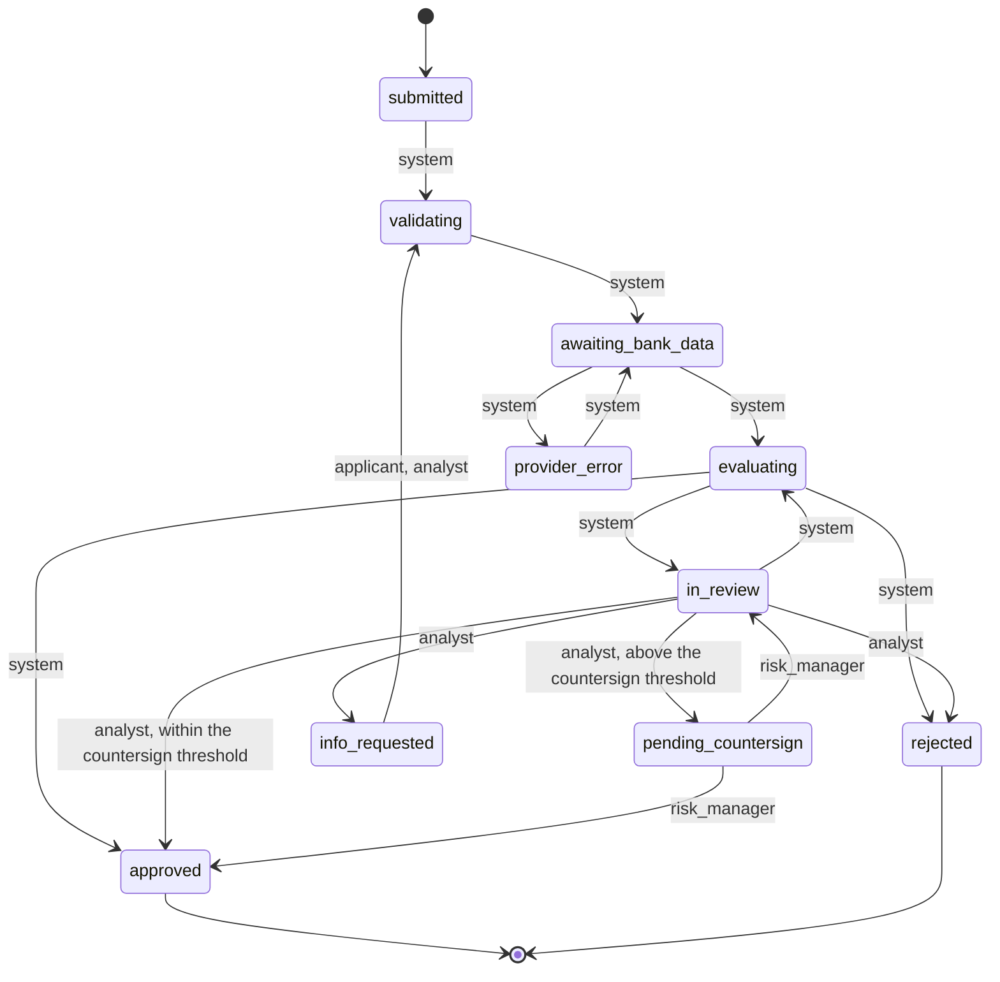
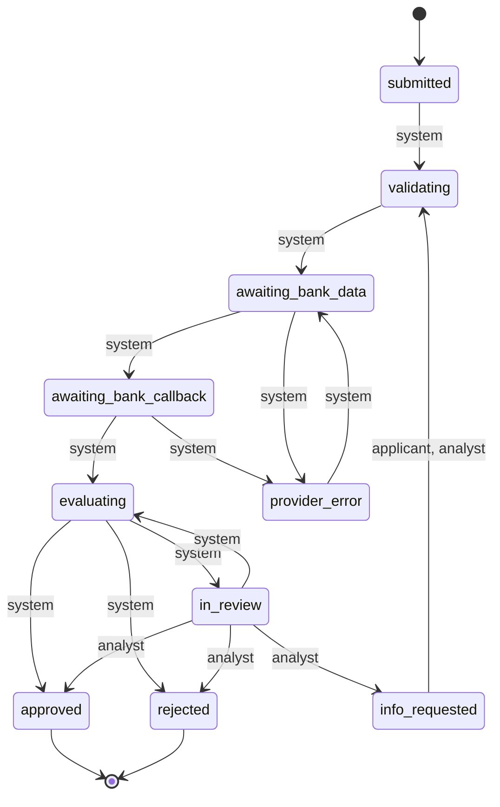
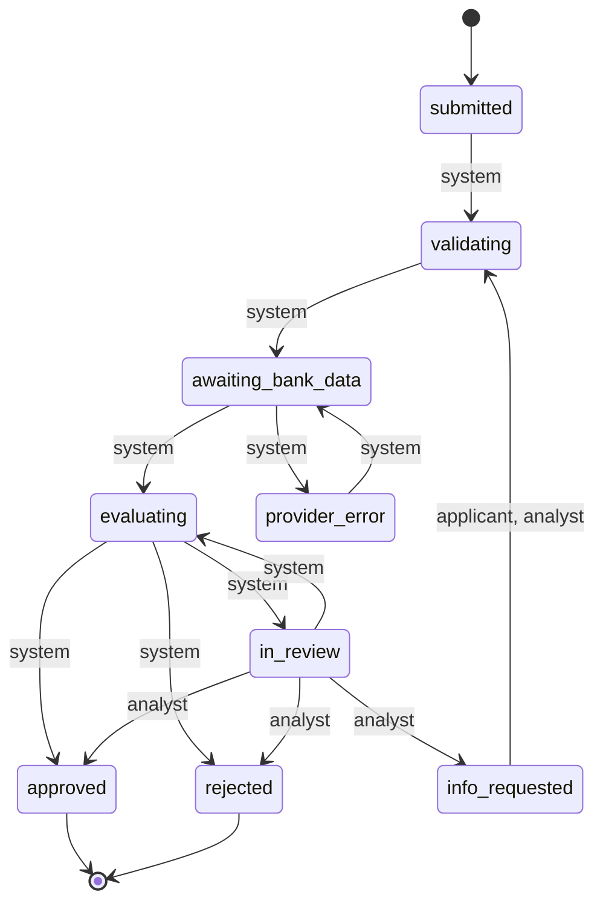

# Life cycles

Generated by `mix fides.gen.lifecycles` from each country's life cycle. Do not edit by hand.

Every open state can also move to `cancelled`, by the applicant or an analyst. The diagrams leave those moves out so they can be read.

## ES

Bank data comes back with the request. An analyst's approval above the policy's threshold needs a risk manager's countersignature.

| On entering | What runs |
| --- | --- |
| `submitted` | The orchestrator moves it to `validating` |
| `validating` | Agent `intake` |
| `awaiting_bank_data` | Agent `banking` |
| `evaluating` | Agent `risk` |
| `in_review` | Enters the `review` queue; AI capability `case_brief` |
| `info_requested` | Signed webhook `info_requested`; Notice to the applicant, `info_requested` |
| `provider_error` | Scheduled retry, back to `awaiting_bank_data`; Alert on the console, `provider_error` |
| `pending_countersign` | Enters the `countersign` queue |
| `approved` | Signed webhook `approved`; Notice to the applicant, `approved` |
| `rejected` | Signed webhook `rejected`; Notice to the applicant, `rejected` |
| `cancelled` | Nothing |

## PT

Bank data comes back with the request. An analyst's approval above the policy's threshold needs a risk manager's countersignature.

| On entering | What runs |
| --- | --- |
| `submitted` | The orchestrator moves it to `validating` |
| `validating` | Agent `intake` |
| `awaiting_bank_data` | Agent `banking` |
| `evaluating` | Agent `risk` |
| `in_review` | Enters the `review` queue; AI capability `case_brief` |
| `info_requested` | Signed webhook `info_requested`; Notice to the applicant, `info_requested` |
| `provider_error` | Scheduled retry, back to `awaiting_bank_data`; Alert on the console, `provider_error` |
| `pending_countersign` | Enters the `countersign` queue |
| `approved` | Signed webhook `approved`; Notice to the applicant, `approved` |
| `rejected` | Signed webhook `rejected`; Notice to the applicant, `rejected` |
| `cancelled` | Nothing |

## IT

Bank data comes back with the request. An analyst's approval above the policy's threshold needs a risk manager's countersignature.

| On entering | What runs |
| --- | --- |
| `submitted` | The orchestrator moves it to `validating` |
| `validating` | Agent `intake` |
| `awaiting_bank_data` | Agent `banking` |
| `evaluating` | Agent `risk` |
| `in_review` | Enters the `review` queue; AI capability `case_brief` |
| `info_requested` | Signed webhook `info_requested`; Notice to the applicant, `info_requested` |
| `provider_error` | Scheduled retry, back to `awaiting_bank_data`; Alert on the console, `provider_error` |
| `pending_countersign` | Enters the `countersign` queue |
| `approved` | Signed webhook `approved`; Notice to the applicant, `approved` |
| `rejected` | Signed webhook `rejected`; Notice to the applicant, `rejected` |
| `cancelled` | Nothing |

## MX

The bank provider delivers the data later, through a signed webhook. An analyst's approval is final.

| On entering | What runs |
| --- | --- |
| `submitted` | The orchestrator moves it to `validating` |
| `validating` | Agent `intake` |
| `awaiting_bank_data` | Agent `banking` |
| `awaiting_bank_callback` | Timeout `bank_callback` |
| `evaluating` | Agent `risk` |
| `in_review` | Enters the `review` queue; AI capability `case_brief` |
| `info_requested` | Signed webhook `info_requested`; Notice to the applicant, `info_requested` |
| `provider_error` | Scheduled retry, back to `awaiting_bank_data`; Alert on the console, `provider_error` |
| `approved` | Signed webhook `approved`; Notice to the applicant, `approved` |
| `rejected` | Signed webhook `rejected`; Notice to the applicant, `rejected` |
| `cancelled` | Nothing |

## CO

Bank data comes back with the request. An analyst's approval is final.

| On entering | What runs |
| --- | --- |
| `submitted` | The orchestrator moves it to `validating` |
| `validating` | Agent `intake` |
| `awaiting_bank_data` | Agent `banking` |
| `evaluating` | Agent `risk` |
| `in_review` | Enters the `review` queue; AI capability `case_brief` |
| `info_requested` | Signed webhook `info_requested`; Notice to the applicant, `info_requested` |
| `provider_error` | Scheduled retry, back to `awaiting_bank_data`; Alert on the console, `provider_error` |
| `approved` | Signed webhook `approved`; Notice to the applicant, `approved` |
| `rejected` | Signed webhook `rejected`; Notice to the applicant, `rejected` |
| `cancelled` | Nothing |

## BR

Bank data comes back with the request. An analyst's approval is final.

| On entering | What runs |
| --- | --- |
| `submitted` | The orchestrator moves it to `validating` |
| `validating` | Agent `intake` |
| `awaiting_bank_data` | Agent `banking` |
| `evaluating` | Agent `risk` |
| `in_review` | Enters the `review` queue; AI capability `case_brief` |
| `info_requested` | Signed webhook `info_requested`; Notice to the applicant, `info_requested` |
| `provider_error` | Scheduled retry, back to `awaiting_bank_data`; Alert on the console, `provider_error` |
| `approved` | Signed webhook `approved`; Notice to the applicant, `approved` |
| `rejected` | Signed webhook `rejected`; Notice to the applicant, `rejected` |
| `cancelled` | Nothing |
